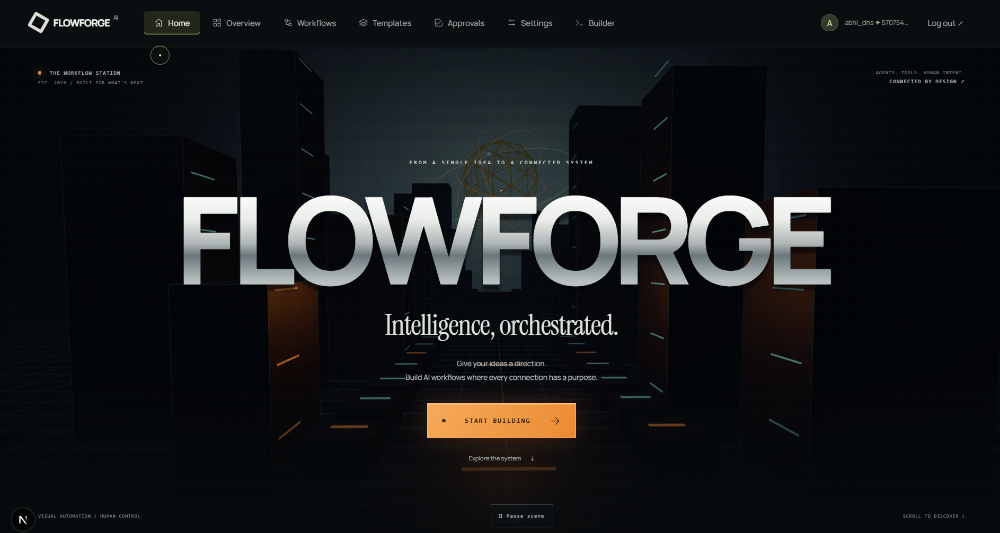
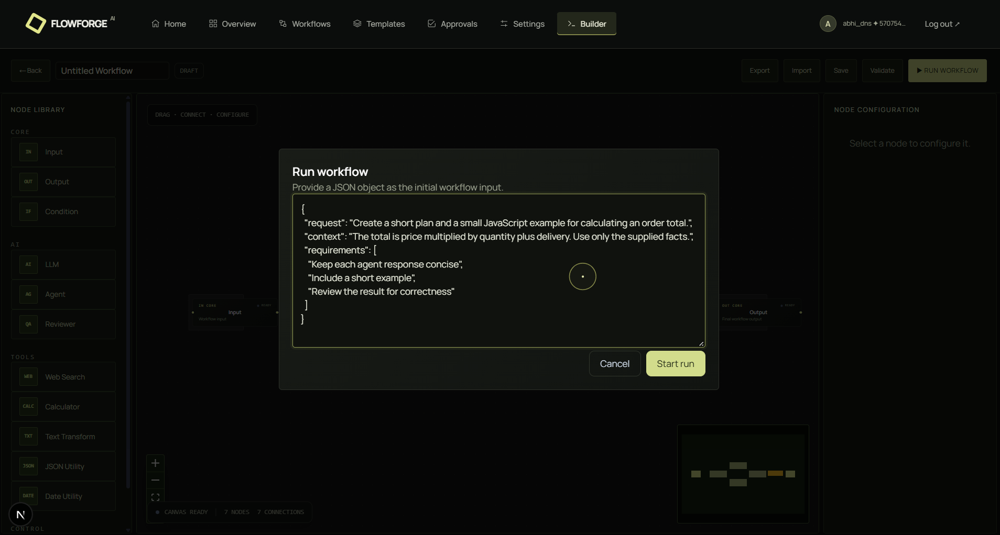
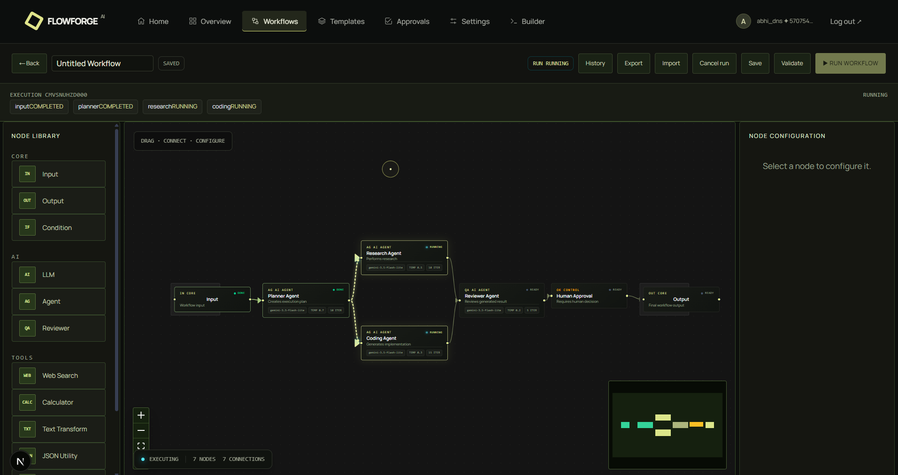
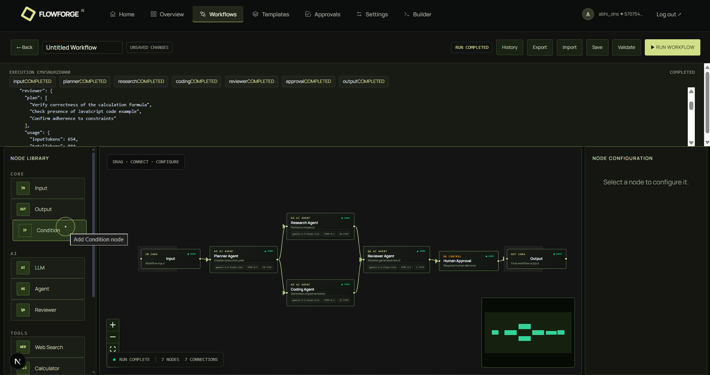

# FlowForge AI — MultiAgent Workflow Builder

A visual workflow application built with Next.js, NestJS, PostgreSQL/Prisma and a Python/FastAPI AI service. Build and save graphs, configure Gemini/GPT nodes, execute parallel branches, inspect persisted runs, approve human decisions, and use bounded data tools or Google-grounded web search.

## Website screenshots

Latest interface screenshots supplied on **29 October 2026**.

### Landing page

The cinematic Three.js environment, Home navigation and entry point into the workflow builder.



### Run a workflow

Provide JSON input before starting an execution from the visual builder.



### Live workflow execution

The canvas shows completed steps and the Research and Coding agents running in parallel, with directional flow toward review and human approval. This image captures an in-progress run, not a completed result.



### Completed workflow

The execution console and canvas show all seven steps completed, including the parallel agents, review, human approval and final output.



## Services

- `apps/api`: NestJS API with PostgreSQL/Prisma-backed registration, login, and workflow CRUD
- `apps/ai`: FastAPI service with LangGraph routing selected `gpt-*` models to OpenAI and `gemini-*` models to Gemini for structured output
- `apps/web`: animated workflow editor, templates, history, approval inbox, dashboard and AI/workspace settings
- `packages/contracts`: provisional workflow JSON Schema
- `eval/tau3`: separate location for future τ³-bench evaluation setup

The Nest worker owns graph execution; Python owns provider calls. The `eval/tau3` environment remains separate from product services. See the [current completion review](docs/implementation/completion-2026-10-28.md) for verified functionality and remaining account/configuration limitations.

## Run locally

Use Node.js 24, Python 3.12–3.14, and Docker Desktop for local PostgreSQL. Install JavaScript dependencies with `npm ci`. Create `apps/ai/.venv` with `python -m venv apps/ai/.venv`, then install the AI package with `apps/ai/.venv/Scripts/python.exe -m pip install -e apps/ai` on Windows (`apps/ai/.venv/bin/python` on Linux/macOS).

Create local environment files from the examples only when they do not already exist. Set `DATABASE_URL`, `JWT_SECRET`, and matching `AI_SERVICE_SECRET` values in the root `.env` and `apps/ai/.env`; configure provider keys only on the server. Set `WEB_SEARCH_ENABLED=true` in the AI service environment to permit Google-grounded searches.

Start Docker Desktop, then from the repository root:

```powershell
npm run dev:all
```

Open **http://localhost:3002**. The API defaults to port 3001 and AI uses 8000. If 3001 is occupied, configure API port 3101 as described under [Local port conflicts](#local-port-conflicts); the frontend remains on 3002. The API startup applies pending migrations without resetting data. For separate terminals, use `npm run dev:api` (which also manages AI) and `npm run dev` (web). Use `npm run dev:ai` separately only when restoring a missing AI service or deliberately managing it yourself; the API launcher reuses it.

The API **development** command checks AI readiness and starts the local Python service if port 8000 has no AI service. It reuses an already-running AI service and checks the shared secret before starting Nest. `npm run dev:all` uses the same managed startup. Set `START_LOCAL_AI=false` only for deliberately running an API without AI; production startup never launches Python automatically.

Canvas arrows show source-to-target direction. Running branches display moving packets; paused approvals stop flow. Short completed runs replay their verified path with a `COMPLETED · PATH REPLAY` label, while node labels keep their actual completed state.

Health: `http://localhost:3002/api/health/ready` through the frontend proxy, and `http://localhost:8000/ai/health` directly. The proxy health URL works with either configured API port. Model/key status: sign in and open **Settings**. To run web search, use **Templates → Web search with sources** with `{"query":"your question"}`.

```powershell
npm test
npm run test:integration
```

Integration tests use a unique migrated PostgreSQL schema and a fake AI HTTP service, then clean up only that schema. `npm run test:integration:live` explicitly uses the configured live AI service and can consume provider quota.

Real Gemini generation is verified. The latest OpenAI generation and Gemini search checks returned HTTP 429; those features need account quota/credits before live calls can succeed. Optional paired desktop automation is not implemented. Deployment is excluded from the current work.

See [local setup](docs/implementation/local-development.md), [API contracts](docs/api-contracts.md), and [current verification](docs/implementation/completion-2026-10-28.md).

## Interface and motion

The landing page uses an original Three.js city scene with metallic type, GSAP entrance motion and a pause/resume control. The rest of the app shares charcoal panels, warm accents and isometric connection graphics. Palette and configuration panels remain accessible on mobile.

Three.js loads only on the landing page. Browsers without WebGL retain a CSS fallback, and reduced-motion preferences disable decorative movement. Run results and dashboard figures still come from the API/database. See the [29 October visual redesign notes](docs/implementation/ui-redesign-2026-10-29.md) for scope and verification.

## Login and navigation

Successful email/password sign-in, GitHub sign-in and Google sign-in take users to the **landing page (`/`) first**. New email registrations also open the landing page automatically. A previous protected-page `next` parameter does not override this landing-first behavior.

- **Home** in the main navigation returns to the landing page from the workspace.
- Standalone **Login** and **Sign up** screens have their own **Home** control.
- The FlowForge logo also links to the landing page.
- After signing in, use **Workflows**, **Templates**, **Builder**, **Approvals**, **Settings**, or **Overview** (the dashboard) to continue.

### Try your first workflow

1. Open `http://localhost:3002/signup` to create an account, or `/login` to sign in.
2. Once the landing page opens, choose **Templates → Parse structured JSON → Use template**.
3. Click **Validate**, then **Run Workflow**.
4. Paste this runtime input and click **Start run**:

```json
{
  "json": "{\"project\":\"FlowForge AI\",\"ready\":true}"
}
```

5. Confirm the run completes and its output contains the parsed `project` and `ready` fields. This workflow needs no AI key and consumes no AI tokens.
6. Open **History** for saved node results, or **Overview** for real workspace metrics. Click **Home** whenever you want to return to the landing page.

For an AI-backed example, import [the order-total workflow](examples/workflows/order-total-review.json) and run it with [the matching input](examples/inputs/order-total-input.json). Choose a model with a configured provider key; the Calculator result should be **1048**, followed by AI review and human approval.

## Local port conflicts

Development commands now reuse an already-running FlowForge frontend/API instead of starting a competing listener. `npm run dev:all` reads the configured API port and starts only missing services. A port owned by a different application is reported; that application is never stopped automatically.

If another project uses port 3001, set `API_PORT=3101` in the root `.env` and `apps/api/.env`, and `API_INTERNAL_URL=http://127.0.0.1:3101` in `apps/web/.env.local`. Restart the affected development terminals. Open the frontend at `http://localhost:3002`. Use either `npm run dev:all` or separate API/web terminals. Startup guard tests: `npm run test:startup`.

## OAuth callback setup

For this local setup, register `http://localhost:3002/api/auth/github/callback` as the **Authorization callback URL** in the FlowForge GitHub OAuth app. Set `GITHUB_CALLBACK_URL` to the same value in your API environment. For Google, use `http://localhost:3002/api/auth/google/callback` as an authorized redirect URI and `GOOGLE_CALLBACK_URL` value. These URLs go through the frontend proxy, so a separate application on port 3001 cannot receive FlowForge's callback. After changing provider environment variables, restart the API.

Use a dedicated OAuth app for FlowForge if your existing OAuth credentials belong to another project. Provider registration changes must be made in the provider account; changing a local environment file does not update GitHub or Google settings.

### GitHub reports “redirect_uri is not associated with this application”

Check that the **Client ID** in your API environment belongs to the same OAuth app whose settings you are editing. Its saved authorization callback must match `http://localhost:3002/api/auth/github/callback` exactly, including the port and `/api` prefix. Save the provider settings, restart the API if its environment changed, close the old GitHub warning tab, and begin a fresh sign-in from FlowForge. Do not share the client secret in bug reports.

### Login hydration warning after updating the interface

Refresh the login page with **Ctrl+Shift+R** after updating the frontend. Shared route transitions now animate only their own decorative overlay; they do not modify streamed login/signup elements before hydration. Auth pages respect reduced-motion settings without changing GSAP's global timeline speed. Report a warning that persists after a fresh reload with its route and console message.
